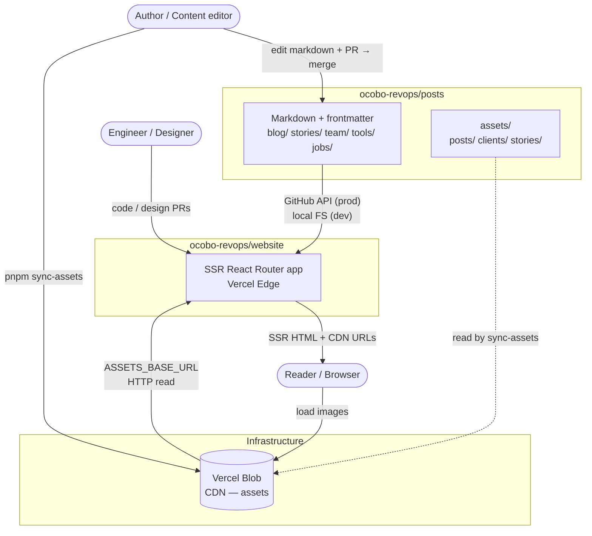
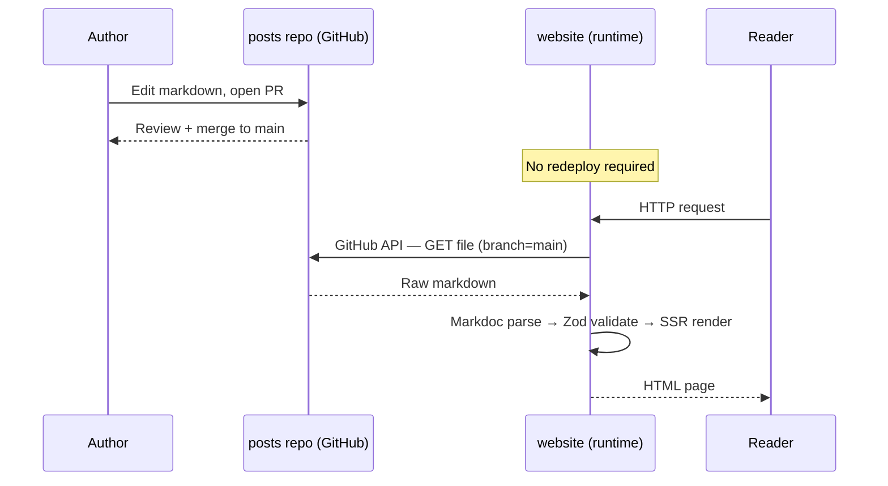
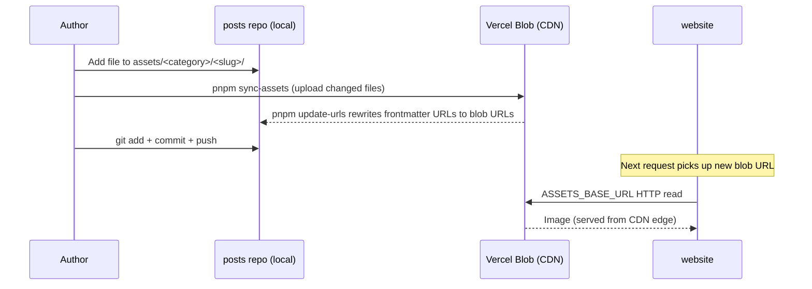
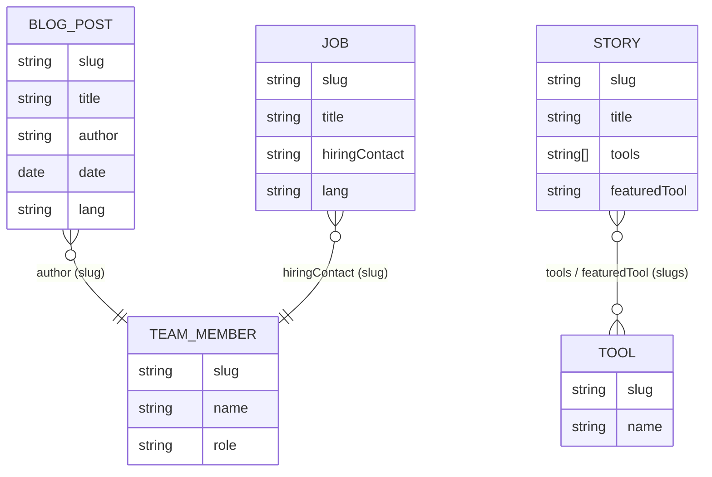

# Two-repo content pipeline

## Overview

Ocobo's content lives in a dedicated repository (`ocobo-revops/posts`) separate from the website code (`ocobo-revops/website`). The website is a **pure read-side consumer** — it never writes content and never needs to redeploy when content changes.

| Repo | Responsibility | Who touches it |
|------|----------------|----------------|
| `ocobo-revops/posts` | Markdown content + assets | Content editors, RevOps writers |
| `ocobo-revops/website` | SSR React Router app | Engineers, designers |

---

## System diagram

---

## Content flow

How a markdown change reaches readers:

**Local dev** (`CONTENT_SOURCE=locale`): the website reads directly from `~/projects/ocobo-posts/` on the filesystem — no GitHub API call, instant feedback.

**Production** (`CONTENT_SOURCE=github`): every request hits the GitHub API; the Vercel CDN caches the rendered page (`stale-while-revalidate`). Append `?refresh=1` to bypass cache.

---

## Asset flow

How an image added to `posts` ends up on the website:

Assets are stored in Vercel Blob under paths like `content/posts/<slug>/filename.png`. The blob store (`ocobo-blob`) is owned by the `wab` Vercel account; it is accessible to the website via `BLOB_READ_WRITE_TOKEN`.

---

## Content-type relationships

Cross-references between content types always use **slugs** (kebab-case filename without `.md`). The canonical glossary for these terms lives in [`posts/CONTEXT.md`](https://github.com/ocobo-revops/posts/blob/main/CONTEXT.md).

---

## Repo boundaries — which repo do I PR against?

| Change | Repo |
|--------|------|
| New blog post, story, job | `ocobo-revops/posts` |
| Edit existing content text | `ocobo-revops/posts` |
| Add or replace an image / asset | `ocobo-revops/posts` (then run `pnpm sync-assets`) |
| New team member or tool | `ocobo-revops/posts` |
| Fix a rendering bug | `ocobo-revops/website` |
| Add a new page or route | `ocobo-revops/website` |
| Update design tokens or components | `ocobo-revops/website` |
| Add a new content type (schema) | `ocobo-revops/website` (Zod schema + route) **and** `ocobo-revops/posts` (markdown files) |
| Change cache TTL | `ocobo-revops/website` — `app/modules/cache.ts` |

---

## Environment variables (website side)

| Var | When set | Effect |
|-----|----------|--------|
| `CONTENT_SOURCE=locale` | Dev (default) | Reads from local `~/projects/ocobo-posts/` filesystem |
| `CONTENT_SOURCE=github` | Prod | Fetches via GitHub API |
| `GITHUB_ACCOUNT` / `GITHUB_REPO` / `GITHUB_ACCESS_TOKEN` | When `github` | Content repo coordinates |
| `GITHUB_BRANCH` | Optional | Defaults `main`; use `offers` to preview placeholder branches |
| `ASSETS_BASE_URL` | Prod | Base URL for Vercel Blob CDN |
| `BLOB_READ_WRITE_TOKEN` | Both | Blob store access token |

---

## Further reading

- [`posts/CONTEXT.md`](https://github.com/ocobo-revops/posts/blob/main/CONTEXT.md) — content domain glossary
- [`docs/architecture/overview.md`](overview.md) — website internal architecture
- [`docs/development/cache-strategy.md`](../development/cache-strategy.md) — CDN cache TTLs and bypass
- [`app/modules/content/api.ts`](../../app/modules/content/api.ts) — content public API
- [`app/modules/content/factory.ts`](../../app/modules/content/factory.ts) — source dispatch (locale vs github)
